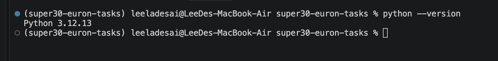
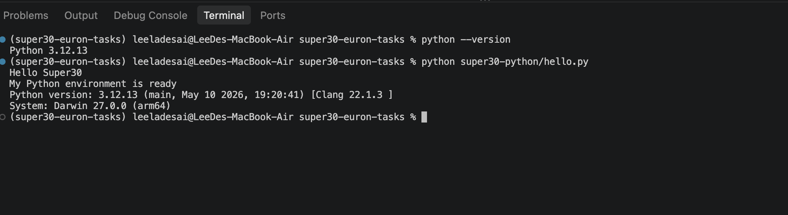
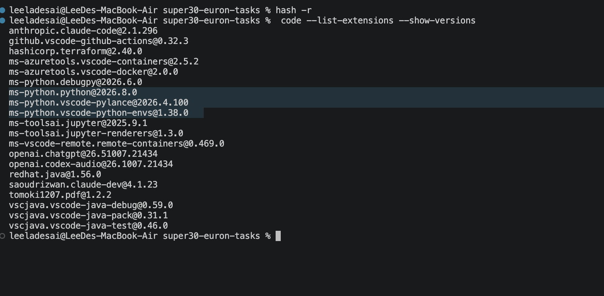
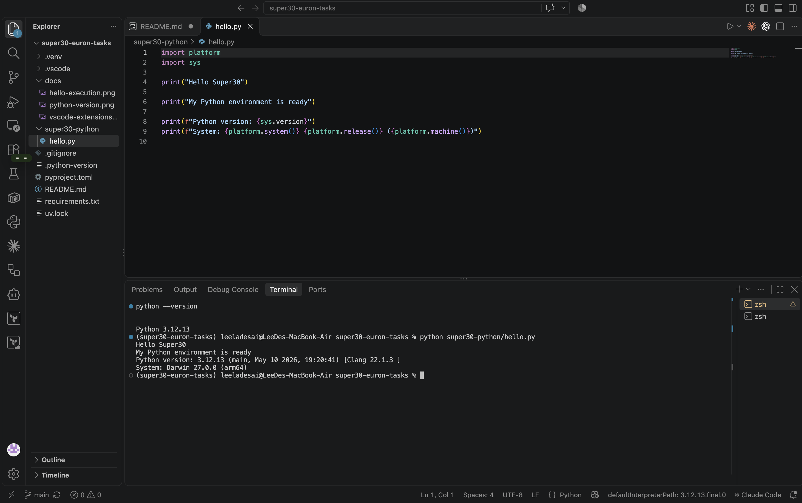

# Super30 Euron Tasks

Setup and first Python program for the Super30 course. It sets up Python 3.12 with `uv` and VS Code, then verifies the setup by running `hello.py`.

> **Note on evidence:** The environment details in this README (Python 3.12.13, VS Code 1.141.0, installed extensions, terminal) were captured on my own machine and cannot be confirmed from the source files alone. The screenshots in [`docs/`](docs/) are the evidence for them. The [Verification summary](#verification-summary) maps each claim to the file or screenshot that backs it, and [Reproduce the check](#reproduce-the-check) shows how to re-run it on any machine.

## Contents

- [Verification summary](#verification-summary)
- [Environment setup](#environment-setup)
- [Setup steps](#setup-steps)
- [Project structure](#project-structure)
- [Running the program](#running-the-program)
- [Reproduce the check](#reproduce-the-check)
- [Screenshots](#screenshots)
  - [Python version](#python-version)
  - [Program execution](#program-execution)
  - [VS Code extensions](#vs-code-extensions)
  - [VS Code workspace](#vs-code-workspace)

## Verification summary

| Claim | Checkable from source? | Where to check |
|---|---|---|
| Project needs Python 3.12 or newer | Yes | `requires-python = ">=3.12"` in `pyproject.toml` |
| Python 3.12 is pinned | Yes | `.python-version` contains `3.12` |
| The program reports the interpreter and OS | Yes | `super30-python/hello.py` prints `sys.version` and `platform` details |
| VS Code uses the project venv | Yes | `.vscode/settings.json` sets `python.defaultInterpreterPath` to `.venv/bin/python` |
| Recommended extensions are declared | Yes | `.vscode/extensions.json` (Python, Pylance) |
| Installed interpreter is Python 3.12.13 | No, local machine | [python-version.png](docs/python-version.png), [vscode-workspace.png](docs/vscode-workspace.png) |
| `hello.py` runs in the VS Code terminal | No, local machine | [hello-execution.png](docs/hello-execution.png), [vscode-workspace.png](docs/vscode-workspace.png) |
| VS Code 1.141.0 and the listed extensions are installed | No, local machine | [vscode-extensions.png](docs/vscode-extensions.png) |

## Environment setup

| Item | Details |
|---|---|
| Operating system | macOS (Apple Silicon) |
| Python version | 3.12.13 (output of `python --version`) |
| Environment manager | `uv`, with a virtual environment in `.venv` |
| Editor | Visual Studio Code 1.141.0 |
| VS Code extensions | Python (ms-python.python), Pylance (ms-python.vscode-pylance), Python Debugger (ms-python.debugpy), Python Environments (ms-python.vscode-python-envs), Jupyter (ms-toolsai.jupyter) |
| Terminal | VS Code integrated terminal, zsh |

## Setup steps

1. Install Python 3.12 with uv: `uv python install 3.12`
2. Create the virtual environment: `uv venv`
3. Activate it: `source .venv/bin/activate`
4. Check the interpreter: `python --version`, which prints `Python 3.12.13`
5. In VS Code, select the interpreter with `Cmd+Shift+P`, then "Python: Select Interpreter", then `.venv`.

## Project structure

```
.
├── README.md
├── pyproject.toml      # project metadata, requires Python >= 3.12
├── .python-version     # pins Python 3.12
├── uv.lock             # uv lockfile
├── .gitignore
├── requirements.txt    # empty, no third-party dependencies
├── .vscode/
│   ├── extensions.json # recommended extensions (Python, Pylance)
│   └── settings.json   # interpreter set to .venv
├── docs/
│   ├── python-version.png      # python --version in the venv
│   ├── hello-execution.png     # hello.py running in the VS Code terminal
│   ├── vscode-extensions.png   # installed extension list
│   └── vscode-workspace.png    # full VS Code window
└── super30-python/
    └── hello.py        # first program
```

## Running the program

```bash
source .venv/bin/activate
python super30-python/hello.py
```

Expected output (the version and system lines depend on the machine; these are from mine):

```
Hello Super30
My Python environment is ready
Python version: 3.12.13 (main, May 10 2026, 19:20:41) [Clang 22.1.3 ]
System: Darwin 27.0.0 (arm64)
```

## Reproduce the check

On any machine with `uv` installed, these commands confirm the setup without relying on my screenshots:

```bash
uv python install 3.12
uv venv
source .venv/bin/activate
python --version                  # expect Python 3.12.x
python super30-python/hello.py    # expect the four lines above, with your own version and system
code --list-extensions --show-versions   # optional, lists installed VS Code extensions
```

## Screenshots

### Python version

`.python-version` pins Python 3.12. With the virtual environment activated, `python --version` reports the matching interpreter:



### Program execution

Running `hello.py` from the VS Code integrated terminal (the Terminal tab of the bottom panel), with the venv active, gives the output shown under [Running the program](#running-the-program):



### VS Code extensions

The `code` command is on the PATH (symlinked to `~/.local/bin/code`), so the installed extensions can be listed from the terminal:

```bash
code --list-extensions --show-versions
```



### VS Code workspace

The full VS Code window with the project open: the Explorer shows the project files, `hello.py` is open in the editor, and the integrated terminal below shows the venv active, `python --version` reporting 3.12.13, and `hello.py` printing its output.


